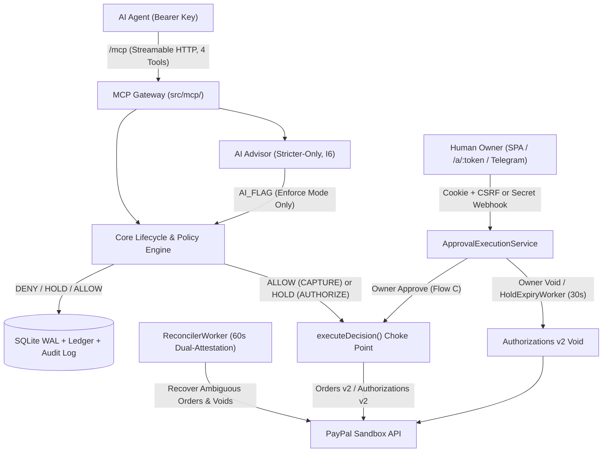

# PayGuard

**Deterministic MCP Policy Firewall for Autonomous AI Agent Payments on PayPal Sandbox**

PayGuard sits between untrusted AI agents and PayPal Sandbox. Agents authenticate over a restricted [Model Context Protocol (MCP)](https://modelcontextprotocol.io/) Streamable HTTP gateway exposing **strictly four canonical tools**, while a deterministic TypeScript policy engine, ACID SQLite ledger, human-in-the-loop approvals, and an isolated execution choke point govern every authorization and capture.

> **Demo Video:** `[DEMO VIDEO URL PLACEHOLDER]` *(YouTube walkthrough link pending upload)*
> **Sandbox Disclaimer:** PayGuard targets PayPal Sandbox exclusively (`https://api-m.sandbox.paypal.com`). Production credentials and real money movement are disabled.

[Architecture](docs/ARCHITECTURE.md) · [Decisions (ADRs)](docs/DECISIONS.md) · [Verification Spikes](docs/SPIKES.md) · [Quick Setup](#quick-setup) · [Judge Demo](#judge-demo-walkthrough) · [License](LICENSE)

---

## Why PayGuard?

Giving AI agents raw payment credentials exposes systems to prompt-injected invoices, lookalike payees, runaway retries, and budget drain. System-prompt instructions alone fail under indirect prompt injection. **PayGuard removes financial authority from the LLM:**

- **Deterministic Policy Engine:** Pure TypeScript rules evaluate integer minor units (`MinorUnits`), merchant registry IDs, rolling 24h budgets, velocity limits, duplicate windows, and categories before PayPal is called (`DENY > HOLD > ALLOW`).
- **Strictly Four MCP Tools (`I1`):** Untrusted agents can only call `request_payment`, `get_payment_status`, `get_budget`, and `list_vendors` — never approve, capture, void, refund, policy-edit, or credential tools.
- **Stricter-Only AI Advisor (`I6`):** Google Gemini provides risk summaries, injection screening, and policy drafts requiring manual confirmation, and can **never** weaken deterministic decisions or initiate money movement.

---

## Architecture Overview



Deep component tables, HTTP/CSRF contracts, state machine transitions, migrations `001`–`012`, and invariants `I1`–`I7` live in [docs/ARCHITECTURE.md](docs/ARCHITECTURE.md).

---

## Capabilities & Operational Modes

| Status | Capability | Summary |
|---|---|---|
| **Always Active** | Deterministic Policy & Ledger | Enforces `DENY > HOLD > ALLOW`, `BEGIN IMMEDIATE` WAL transactions, `RESERVE`/`SPEND`/`RELEASE` ledger math, SHA-256 `audit_log` chaining, snapshot-locked holds, and single execution choke point [`executeDecision`](src/core/executeDecision.ts). |
| **Always Active** | `/mcp` Gateway & Owner Console | Bearer-authenticated Streamable HTTP `/mcp` with per-agent isolation (`403`/`404`), React 19 SPA (`/`), `default-src 'none'` SSR `/a/:token` pages, Argon2id sessions, CSRF checks, 30s expiry worker, and 60s reconciler. |
| **Always Active** | Sandbox Safety Lock | [`loadConfig`](src/config/index.ts) hard-locks `api-m.sandbox.paypal.com` and blocks `PAYPAL_ENV=PRODUCTION` unless `ALLOW_PRODUCTION=true`. |
| **Config-Dependent** | Live PayPal Sandbox | Requires `CONNECTOR_ACME_CLIENT_ID`, `CONNECTOR_ACME_CLIENT_SECRET`, and a vault token (`demo/onboardVault.ts` or `VAULT_TOKEN_ID`). Without them, runs in **local evaluation mode** (`ALLOW` stops at `RECEIVED`). |
| **Config-Dependent** | Google Gemini AI Advisor | Enabled via `AI_PROVIDER=gemini` and `GEMINI_API_KEY` (`gemini-3.5-flash-lite`; defaults to `mock`). `AI_SCAN_MODE=enforce` escalates detected injections to `HOLD`. |
| **Config-Dependent** | Telegram Inline Approvals | Enabled via `TELEGRAM_MODE=webhook`, bot credentials, and 64-hex `TELEGRAM_ENCRYPTION_KEY` (AES-256-GCM buttons + `NotificationOutboxWorker`). |
| **Deferred / Unverified** | Excluded Scope | See [Implementation & Verification Status](#implementation--verification-status) (`stdio`, `/api/paypal/activity`, Docker runtime, live Telegram delivery, Playwright `/a/:token`, `invoice_id`). |

---

## Four Canonical MCP Tools

Served at `POST /mcp` (`Authorization: Bearer <agent_api_key>`, `Accept: application/json, text/event-stream`) from [`src/mcp/tools.ts`](src/mcp/tools.ts):

| Tool | Key Inputs | Guardrails |
|---|---|---|
| `request_payment` | `vendor_id`, `amount`, `currency`, `purpose`, `idempotency_key`, optional `category`, `source_context` | Screens injection + runs policy rules; replays matching `(agent, idempotency_key)` or throws `IDEMPOTENCY_CONFLICT`; runs `CAPTURE` (`ALLOW`) or `AUTHORIZE` (`HOLD`) if Sandbox + vault token are configured. |
| `get_payment_status` | `request_id` | Returns caller-owned status, decision, and reason codes (triggers lazy hold expiry). Never exposes approval URLs or tokens. |
| `get_budget` | `{}` | Returns remaining rolling 24h budget (`Math.min(agent, policy)`) and allowed currencies; hides thresholds unless `expose_limits: true`. |
| `list_vendors` | `{}` | Returns `ACTIVE` and `UNVERIFIED` vendors with allowed categories/currencies; omits `BLOCKED` vendors. |

```json
// Example request_payment call -> Sandbox ALLOW (CAPTURED)
{
  "vendor_id": "ven-acme", "amount": "12.00", "currency": "USD",
  "purpose": "Acme Cloud compute credits", "category": "cloud", "idempotency_key": "idem-q4-001"
}
// -> { "request_id": "req-...", "status": "CAPTURED", "decision": "ALLOW", "reasons": [], ... }
```

---

## PayPal Sandbox & Gemini AI Integration

- **PayPal Sandbox (`src/paypal/`):** Vault v3 setup/approval/exchange and `--replace` rotation ([`demo/onboardVault.ts`](demo/onboardVault.ts)), Orders v2 `CAPTURE` (`ALLOW`) and `AUTHORIZE` (`HOLD`) with `Prefer: return=representation` and `PayPal-Request-Id`, Authorizations v2 capture/void, and 60s `ReconcilerWorker` recovery preserving `OrderError.orderId`. Verified flows in [docs/SPIKES.md](docs/SPIKES.md).
- **Google Gemini (`src/ai/`):** Native `fetch` to Gemini REST `v1beta` (`x-goog-api-key`, `gemini-3.5-flash-lite`, `25s` timeout, Zod `responseJsonSchema`, `20 req/60s` rate cap, 15-min `ai_runs` cache). Powers two-stage `InjectionDetector` (`DETECTED | CLEAR | INDETERMINATE`), advisory `RiskExplainer`, and diff-labeled `PolicyDrafter` (capped at `MAX_HARD_CAP_MINOR`), plus the 5-step bounded [`demo/liveAgent.ts`](demo/liveAgent.ts) harness.

---

## Security & Honest Audit Scope

- **Isolated Execution:** Order creation and captures run solely inside [`executeDecision`](src/core/executeDecision.ts); holds lock on a canonical 7-field SHA-256 `snapshot_hash`.
- **Auth & Secret Hygiene:** Argon2id owner passphrases, SQLite `pg_owner_session` cookies (`HttpOnly`, `SameSite=Strict`, 60m idle / 24h max, fail-closed `503`), `x-csrf-token` on `/api/*`, `_csrf` scoped to `/a/:token/*`, constant-time Telegram secret verification + AES-256-GCM callbacks, and hashed/masked keys and vault tokens.
- **Honest Audit-Chain Limitation:** SQLite `audit_log` rows hash-chain `prev_hash -> hash` with `BEFORE UPDATE`/`DELETE` abort triggers (`verifyDatabaseAuditChain`), catching SQL/app tampering — **but local SQLite without remote WORM anchoring cannot prevent offline disk rewrites by an attacker with OS write access**.

---

## Stack & Repository Layout

- **Stack:** Node.js `>=20`, TypeScript `5.7` (`strict`), Express `5.3`, `@modelcontextprotocol/sdk`, `better-sqlite3` (WAL), `@node-rs/argon2`, Zod `4`, React `19`, Vite `7`, Tailwind `4`, Vitest `3`, ESLint `9`.

```text
src/{ai,api,approvals,auth,config,core,db,mcp,paypal,policy,telegram}/  # Server runtime & policy core
web/src/                                                                # React 19 Owner Dashboard SPA
demo/{seed,reset,honestAgent,attackSimulator,liveAgent,onboardVault}.ts # Demo & onboarding CLIs
docs/{ARCHITECTURE,DECISIONS,SPIKES}.md  |  scripts/spikes/  |  test/   # Docs, sandbox probes, Vitest suites
```

---

## Quick Setup

Requires **Node.js `>= 20.0.0`** and **npm `>= 10.0.0`**.

```bash
npm ci
cp .env.example .env
npm run build
node --env-file=.env --import tsx demo/seed.ts
# Optional (requires CONNECTOR_ACME_* in .env): onboard PayPal Sandbox buyer wallet
node --env-file=.env --import tsx demo/onboardVault.ts --vendor ven-acme
# Start dashboard (http://localhost:3000), health (/healthz), and MCP (/mcp)
node --env-file=.env dist/src/server.js
```

- Copy the one-time `DEMO_AGENT_API_KEY` printed by `demo/seed.ts` into `.env`. Optional Argon2id hash: `node -e "import('@node-rs/argon2').then(m => m.hash(process.argv[1]).then(console.log))" "<passphrase>"`.
- Use `npm run dev:web` during frontend development (proxies `/api`, `/a`, `/healthz` to `:3000`). A non-root [`Dockerfile`](Dockerfile) is included (code-reviewed; Docker runtime not live-verified).

### Environment Variables ([`.env.example`](.env.example))

| Group | Variables (Names Only) & Defaults / Notes |
|---|---|
| **Runtime & DB** | `NODE_ENV` (`development`), `PORT` (`3000`), `PUBLIC_BASE_URL` (auto dev origin; no localhost in prod), `DB_PATH` (`./data/payguard.db`; `DATABASE_PATH` takes precedence), `TRUST_PROXY` (`false`) |
| **Sandbox Lock** | `PAYPAL_ENV` (`SANDBOX`), `ALLOW_PRODUCTION` (`false` — must stay unset/false), `CONNECTOR_ACME_CLIENT_ID`, `CONNECTOR_ACME_CLIENT_SECRET`, `VAULT_TOKEN_ID` |
| **Auth & Policy** | `SESSION_SECRET` (set strong `>=16` char secret in prod), `OWNER_PASSPHRASE_HASH` (Argon2id; unset `demo:seed` uses dev passphrase `payguard-demo-passphrase`), `HOLD_TTL_MINUTES` (`15`), `MAX_HARD_CAP_MINOR` (`1000000` = `$10k`), `RESEED_ON_BOOT` (`false`), `DEMO_AGENT_API_KEY` |
| **Gemini AI** | `AI_PROVIDER` (`mock` \| `gemini`), `AI_MODEL` (`gemini-3.5-flash-lite`), `GEMINI_API_KEY`, `AI_SCAN_MODE` (`advisory` \| `off` \| `enforce`) |
| **Telegram** | `TELEGRAM_MODE` (`disabled` \| `webhook`), `TELEGRAM_BOT_TOKEN`, `TELEGRAM_BOT_USERNAME`, `TELEGRAM_WEBHOOK_SECRET`, `TELEGRAM_OWNER_CHAT_ID`, `TELEGRAM_ENCRYPTION_KEY` (64-hex), `TELEGRAM_PREVIOUS_ENCRYPTION_KEY` |

---

## Judge Demo Walkthrough

Run against your seeded server (`node --env-file=.env dist/src/server.js`):

1. **Health Check:** Verify `GET http://localhost:3000/healthz` returns `{"status":"ok","service":"payguard-mcp","tools":4}`.
2. **Owner Sign-In:** Open `http://localhost:3000` and log in with your passphrase (`payguard-demo-passphrase` if `OWNER_PASSPHRASE_HASH` was unset).
3. **Inspect Rules:** View **Vendors** (`ven-acme`, `ACTIVE`) and **Policies** (`v1`: `$15` auto, `$100` cap, `$50` agent 24h, `$200` global 24h, 5 req/10m, 15m TTL).
4. **Honest Agent:** Run `node --env-file=.env --import tsx demo/honestAgent.ts` — connects to `:3000/mcp`, lists the 4 tools, and checks `get_budget` and `list_vendors`.
5. **Automated `ALLOW`:** Observe its `$12.00 USD` payment evaluate as `ALLOW` (`CAPTURED` on Sandbox, or `RECEIVED` in local evaluation mode).
6. **AI Prompt-Injection Harness:** Run `node --env-file=.env --import tsx demo/liveAgent.ts --provider mock` (or `--provider gemini` with `GEMINI_API_KEY`; add `--execute-sandbox` to allow remote captures) to inspect `invoice-poisoned.txt` interception in an isolated in-memory harness. *(To create a live `HELD` transaction on `:3000/mcp`, submit a `$20.00` request to `ven-acme`.)*
7. **Human Review:** Open **Approvals** (`#/approvals`) or `/a/:token` on a `HELD` payment to review deterministic explanations, advisory AI risk notes, and escaped `source_context`.
8. **Approve or Void:** Click **Approve** (Flow C capture via `executeDecision`) or **Void** (Flow D remote void + `RELEASE` ledger row).
9. **Audit & Budget Check:** Inspect **Overview**, **Payment Detail**, and **Audit Log** (`#/audit`).
10. **Adversarial Matrix:** Run `npm run demo:attack` (isolated `:memory:` DB + mocked PayPal) to verify all 12 attack vectors end with **`$0.00 USD` unauthorized spend**. Reset demo transactions anytime with `node --env-file=.env --import tsx demo/reset.ts` (or `npm run demo:reset` / `npm run agent:create -- "Name" 50`).

---

## Implementation & Verification Status

| Area | Verified Scope | Transparent Gaps / API Pointer |
|---|---|---|
| **Static Checks & Tests** | `npm run typecheck`, `npm run lint`, and `npm run test:unit` (`64` files / `1,434` tests across core, DB, auth, AI, Vault rotation, Telegram) pass. | Integration suites use isolated DBs and mocked external HTTP/AI/Telegram transports. |
| **Live Integrations** | Vault v3 onboard/replace on `ven-acme`, Orders v2 `CAPTURE`/`AUTHORIZE`, Authorizations v2 capture/void, `ReconcilerWorker`, Gemini `gemini-3.5-flash-lite`, and `/mcp` runtime verified ([docs/SPIKES.md](docs/SPIKES.md)). | `stdio` deferred ([D22](docs/DECISIONS.md#d22-streamable-http-mcp-sole-supported-mcp-transport-deferring-stdio)); `/api/paypal/activity` stubbed ([D23](docs/DECISIONS.md#d23-deferred-paypal-toolkit-panel-m5-t8--targeted-console-masking)); Docker boot, live Telegram delivery, Playwright `/a/:token`, and `invoice_id` unverified; full API contract in [docs/ARCHITECTURE.md](docs/ARCHITECTURE.md#3-http-browser--mcp-endpoint-contract). |

---

## License & Contributing

Licensed under the [MIT License](LICENSE). Contributions must adhere to [AGENTS.md](AGENTS.md) (Sandbox-only, 4 MCP tools, `MinorUnits`, atomic `audit_log`, fail-closed rules, and passing `typecheck`, `lint`, and `test:unit`).
