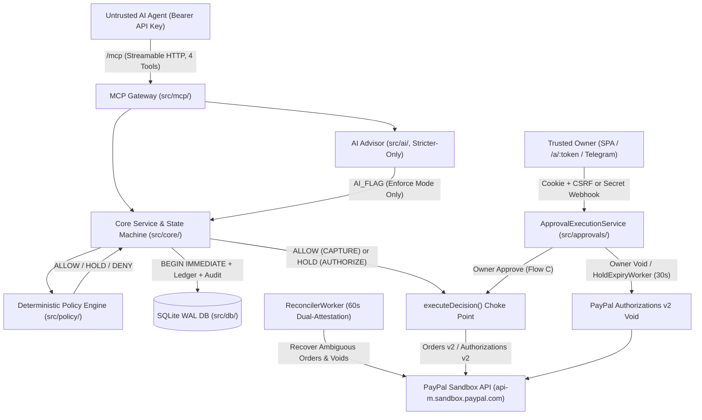

# PayGuard Architecture

PayGuard is an **MCP policy firewall** sitting between AI agents and PayPal Sandbox. Untrusted AI agents can only discover and request payments through four canonical MCP tools over Streamable HTTP (`/mcp`), while a deterministic policy engine evaluates rules to **ALLOW** (Orders v2 `CAPTURE`), **HOLD** (native Orders v2 `AUTHORIZE` hold requiring owner approval), or **DENY**.

> **Verification Boundary**: Core policy evaluation, SQLite transactional state machine, MCP isolation, owner auth/CSRF (API and browser `/a/:token`), AI strictness invariants, and Telegram webhook/callback security are **implemented and unit-tested** (`64` Vitest files, `1,434` tests). Live PayPal Sandbox end-to-end payment flows (`C1`/`C2`/`C3`), live Gemini `gemini-3.5-flash-lite` inference (`S8`/`C3`), and runtime `/healthz` + dashboard + 4-tool `/mcp` serving are **live-verified**. Docker container execution, live Telegram Bot API delivery, live interactive Playwright UI execution, and `M5-T8` PayPal activity reporting are **not live-verified or deferred** (see [README.md](../README.md#implementation--verification-status)).

---

## 1. High-Level Diagram



---

## 2. Component Responsibilities

| Component | Directory | Responsibility |
|---|---|---|
| **MCP Gateway** | [`src/mcp/`](../src/mcp) | Streamable HTTP transport (`/mcp`), SHA-256 Bearer auth, per-session `agentId` isolation (`403`/`404`), 30 req/min rate limiter, `64kb` body cap, and strictly 4 canonical tools (`request_payment`, `get_payment_status`, `get_budget`, `list_vendors`). (`stdio` transport deferred per [D22](DECISIONS.md#d22-streamable-http-mcp-sole-supported-mcp-transport-deferring-stdio).) |
| **Core Lifecycle** | [`src/core/`](../src/core) | Idempotent request ingestion, deterministic state machine, atomic `RESERVE` / `SPEND` / `RELEASE` rolling 24h ledger accounting, integer minor-unit math (`MinorUnits`), and SHA-256 hash-chained `audit_log`. [`executeDecision`](../src/core/executeDecision.ts) is the **sole choke point** for PayPal order creation and authorization capture. |
| **Policy Engine** | [`src/policy/`](../src/policy) | Pure deterministic evaluation `(request, facts, policy, aiFlags, now) -> decision` using integer minor units. Collects all triggered reasons (`DENY > HOLD > ALLOW`) and generates fact-disciplined rule explanations ([`explanations.ts`](../src/policy/explanations.ts)). |
| **PayPal Gateway** | [`src/paypal/`](../src/paypal) | Per-connector OAuth cache with 5-min early refresh (`TokenManager`), Vault v3 onboarding/revocation/lookup (`PayPalVaultService`), Orders v2 (`Prefer: return=representation` + reduced-response fallback + `OrderError.orderId` preservation), Authorizations v2 capture/void (`HTTP 200`/`204`), and `ReconcilerWorker` crash recovery. |
| **Approval Service** | [`src/approvals/`](../src/approvals) | Single-use 32-byte approval tokens (stored as SHA-256 digests) bound to immutable `snapshot_hash`, unified `ApprovalExecutionService`, browser `/a/:token` SSR HTML + scoped `_csrf` router, and `HoldExpiryWorker` (30s interval + lazy expiry on reads/approvals). |
| **Telegram Channel** | [`src/telegram/`](../src/telegram) | Optional channel (`TELEGRAM_MODE=disabled\|webhook`): constant-time webhook secret validation, one-time `/start` account linking with link-epoch (`linked_at`) fencing, AES-256-GCM (`PGA1`) encrypted inline Approve/Void buttons, and persistent `NotificationOutboxWorker` (2s poll, 30s claim leases). |
| **AI Services** | [`src/ai/`](../src/ai) | `GeminiProvider` (`gemini-3.5-flash-lite` over Node native `fetch` with `x-goog-api-key`, 25s timeout, Zod `responseJsonSchema`) & `MockAiProvider`, global 20 req/60s rate limiter, 15-min `ai_runs` cache, `InjectionDetector` (`off\|advisory\|enforce`), advisory `RiskExplainer`, and `PolicyDrafter`. |
| **Dashboard & API** | [`src/api/`](../src/api), [`web/`](../web) | Owner REST API (`/api/*`, Argon2id auth, persistent SQLite `owner_sessions`, `x-csrf-token` header verification) and React 19 / Vite 7 / Tailwind CSS 4 SPA (`Overview`, `Payments`, `PaymentDetail`, `Approvals`, `Agents`, `Policies`, `Vendors`, `Audit`, `Settings`). (`GET /api/paypal/activity` returns a deferred stub.) |
| **Persistence** | [`src/db/`](../src/db) | Embedded SQLite (`better-sqlite3`, `journal_mode = WAL`, `foreign_keys = ON`, `synchronous = NORMAL`, `BEGIN IMMEDIATE`), migrations `001`–`012`, append-only audit triggers, and immutable policy/proposal triggers. |
| **Configuration** | [`src/config/`](../src/config) | Strict Zod env validation, Sandbox URL hard lock (`ALLOW_PRODUCTION` refusal guard), and `validateHardCapWithinCeiling()` (`MAX_HARD_CAP_MINOR` enforcement). |

---

## 3. HTTP, Browser & MCP Endpoint Contract

Mounted by [`createPayGuardMcpServer`](../src/mcp/server.ts) and [`startServer`](../src/server.ts):

| Surface | Path(s) | Auth & Verification Rules |
|---|---|---|
| **Health** | `GET /healthz`, `GET /api/healthz` | Public static JSON (`{ status: 'ok', tools: 4 }`). |
| **Agent MCP** | `POST / GET / DELETE /mcp` | `Authorization: Bearer <agent_api_key>` (SHA-256 checked against active `agents` row); session ID in `mcp-session-id` bound strictly to `agentId` (`403` cross-agent, `404` missing/expired); 30 req/min rate limit; `64kb` JSON cap. |
| **Owner Auth** | `POST /api/login`, `POST /api/logout`, `GET /api/session` | `/api/login` is IP-rate-limited (5 attempts / 1 min), verifies Argon2id passphrase (auto-migrating legacy SHA-256), rotates session (`pg_owner_session` cookie: `HttpOnly`, `SameSite=Strict`, `Path=/`, `Secure` in prod; 60m idle / 24h max). Storage failures return `503` without clearing cookies. `/api/logout` requires session + `x-csrf-token`. |
| **Owner API** | `/api/overview`, `/api/requests`, `/api/requests/:id`, `/api/requests/:id/approve`, `/api/requests/:id/void`, `/api/policies`, `/api/policies/draft`, `/api/policies/drafts`, `/api/policies/drafts/:id`, `/api/policies/activate`, `/api/policies/drafts/:id/activate`, `/api/policies/reject`, `/api/policies/drafts/:id/reject`, `/api/vendors`, `/api/agents`, `/api/agents/:id/suspend`, `/api/audit`, `/api/paypal/activity` | Requires active `pg_owner_session` cookie (`401` if absent/expired). Every `POST` endpoint strictly requires matching `x-csrf-token` HTTP header (`403` if missing/mismatched). `/api/requests/:id` enforces lazy hold expiry before returning detail. `/api/paypal/activity` is a deferred `{ enabled: false, transactions: [] }` stub. |
| **Browser Approval** | `GET /a/:token`, `POST /a/:token/approve`, `POST /a/:token/void` | Requires active owner session cookie (`pg_owner_session`; HTML sign-in guidance if browser asks for HTML). Strict `default-src 'none'; frame-ancestors 'none'` CSP and escaped HTML (zero inline JS). State-changing `POST` accepts `x-csrf-token` header OR URL-encoded `_csrf` hidden form field (`limit: 16kb`) strictly scoped to `/a/*`. |
| **Telegram** | `GET /api/telegram/status`, `POST /api/telegram/link-token`, `POST /api/telegram/unlink` | Owner session cookie + `x-csrf-token` header on `POST` routes. |
| **Telegram Webhook** | `POST /api/telegram/webhook` | Verified by `X-Telegram-Bot-Api-Secret-Token` constant-time match BEFORE JSON parsing (`403` if unconfigured or invalid). Enforces `private` chat only, positive numeric `from.id` + `chat.id`, update deduplication, and full 5-point authorization before editing messages. |
| **Dashboard SPA** | `GET /*` (non-API/MCP/health routes) | Serves compiled `dist/web/` static assets and `index.html` fallback for React hash routing (`#/`). |

---

## 4. State Transitions, PayPal Flows & Workers

### Deterministic Payment State Machine

Payment requests follow strict state rules enforced in [`src/core/stateMachine.ts`](../src/core/stateMachine.ts):

```text
RECEIVED -> DENIED                         (terminal; zero ledger rows)
RECEIVED -> AUTO_EXECUTING -> CAPTURED     (Flow A: ALLOW -> Orders v2 CAPTURE -> SPEND)
RECEIVED -> AUTO_EXECUTING -> FAILED       (definitive pre-capture failure -> RELEASE)
RECEIVED -> HELD -> APPROVED -> CAPTURING -> CAPTURED | FAILED  (Flows B & C)
HELD -> VOIDED                             (Flow D: owner void -> RELEASE + remote void)
HELD -> EXPIRED -> VOIDED                  (TTL elapsed -> RELEASE + remote void)
```

- Every state transition inserts an append-only SHA-256 hash-chained `audit_log` row in the same `BEGIN IMMEDIATE` SQLite transaction.
- Network timeouts or reduced/ambiguous HTTP outcomes retain non-terminal `AUTO_EXECUTING` / `CAPTURING` / `HELD` states (preserving ledger `RESERVE` rows and sanitized `OrderError.orderId`) so `ReconcilerWorker` resolves truth from PayPal without double-charging.

### Background Loops

| Loop | Default Interval | Responsibility |
|---|---|---|
| `HoldExpiryWorker` | 30s | Finds expired `HELD` requests (`expires_at <= now`), atomically transitions `HELD -> EXPIRED -> VOIDED` with a single `RELEASE` ledger row, audits as `system`, and voids remotely (`remote_void_status`). Also triggered lazily on `GET /api/requests/:id`, `get_payment_status`, and approval attempts. |
| `ReconcilerWorker` | 60s | Dual-attests stuck `AUTO_EXECUTING`, `CAPTURING`, stale `HELD`, and `PENDING`/`FAILED` remote voids against PayPal Sandbox Orders v2 / Authorizations v2 APIs before recording `SPEND` or `RELEASE`. |
| `NotificationOutboxWorker` | 2s (when Telegram bot active) | Claims pending outbox messages under a 30s lease with cooperative supersession fencing, decrypts `PGA1` AES-256-GCM inline button payloads in memory, enforces at-most-once `sendMessage` on ambiguous timeouts, and dead-letters after bounded retries (`max_attempts = 3`). |
| Owner Session Cleanup | 60s | Purges idle-expired (60m) and absolute-expired (24h) rows from `owner_sessions`. |

---

## 5. SQLite Schema & Migrations (`001`–`012`)

Migrations in [`src/db/schema.ts`](../src/db/schema.ts) run automatically in `BEGIN IMMEDIATE` transactions on `startServer()` and `demo:seed` under `WAL` mode and `foreign_keys = ON`:

| Migration | Tables / Changes Introduced | Integrity Enforcement |
|---|---|---|
| `001_initial_schema` | `owners`, `agents`, `vendors`, `vendor_vault_tokens`, `policy_versions`, `payment_requests`, `ledger`, `approvals`, `audit_log`, `ai_runs` | Single-row `owners.id = 'default'`, `UNIQUE(agent_id, idempotency_key)`, `idx_policy_versions_single_active`, `audit_log` `BEFORE UPDATE`/`BEFORE DELETE` abort triggers. |
| `002_policy_version_immutability` | `idx_policy_versions_version` + triggers | Blocks modifying `rules`, `version`, `author`, `created_at` or deleting rows (only `active` toggle allowed). |
| `003_remote_void_tracking` | `payment_requests.remote_void_status` | Constrained to `PENDING \| CONFIRMED \| FAILED` + partial index for reconciler recovery. |
| `004_ai_runs_cache_index` | `idx_ai_runs_cache_lookup` | Compound `(input_hash, status, created_at DESC)` index for 15-min `SUCCESS` response caching. |
| `005` & `006_harden_proposal_triggers` | `policy_proposals` + hardened triggers | Restricts updates strictly to `PENDING -> ACTIVATED\|REJECTED\|EXPIRED` with consistent timestamps; blocks `DELETE`. |
| `007` & `008_telegram_link_tokens` | `telegram_link_tokens` + `owners.telegram_username` / `telegram_linked_at` | One-time token hashes + unique partial index preventing multi-owner Telegram chat collisions. |
| `009_notification_outbox` | `notification_outbox` | Persistent queue with unique `dedup_key`, `claim_id`, `linked_at` epoch, and retry counters. |
| `010` & `011_telegram_approval_callbacks` | `telegram_approval_callbacks`, `owners.telegram_user_id`, `reply_markup_enc`, `linked_at` | Hash-only callback tokens bound to chat ID, numeric user ID, `snapshot_hash`, and link epoch. |
| `012_owner_sessions` | `owner_sessions` | Stores SHA-256 `session_key` digests, CSRF tokens, and idle/creation timestamps across restarts. |

---

## 6. AI Pipeline Design & Boundaries

- **Providers ([`src/ai/`](../src/ai))**: Supports `'mock'` (default) and `'gemini'`. `GeminiProvider` calls `https://generativelanguage.googleapis.com/v1beta/models/{model}:generateContent` directly over Node 20+ native `fetch` (`x-goog-api-key` header, `25,000ms` timeout, 1 retry on HTTP `429`/`503`, `responseJsonSchema` generated via `z.toJSONSchema()`).
- **Rate Limits & Cache**: Global `AiRateLimiter` (20 req / 60s) + 15-minute `ai_runs` cache by SHA-256 `input_hash` (only `SUCCESS` runs cached; cache hits bypass rate limiting).
- **InjectionDetector**: Stage A applies NFKC Unicode normalization, invisible-character checks (preserving legitimate Indic ZWJ/ZWNJ joiners), HTML entity decoding, and deterministic regex pattern matching before invoking optional Stage B AI classification. Outcomes are `DETECTED | CLEAR | INDETERMINATE`; errors or low confidence become `INDETERMINATE` and never weaken deterministic rules. Under `AI_SCAN_MODE=enforce`, `DETECTED` injects `AI_FLAG` (`ALLOW -> HOLD`); `advisory` (default) audits without changing decisions; `off` disables scanning.
- **PolicyDrafter & RiskExplainer**: Drafts execute Stage A+B injection screening (rejecting `DETECTED` and `INDETERMINATE`), validate `PolicyDocumentSchema` and `MAX_HARD_CAP_MINOR`, classify every field diff as `TIGHTENED | RELAXED | UNCHANGED`, and hash canonical JSON (`proposal_hash`). Proposals require explicit owner review and CSRF-authenticated activation (`author = 'ai_draft_confirmed'`). `RiskExplainer` is purely advisory and skipped on clean `ALLOW` requests.

---

## 7. Trust Boundaries & Honest Security Scope

- **Untrusted**: MCP AI agent clients, invoice text (`purpose`, `source_context`), payment categories, and free-text LLM reasoning outputs.
- **Semi-Trusted**: Structured JSON outputs from `GeminiProvider` (`RiskExplainer`, `InjectionDetector`, `PolicyDrafter`) — schema-validated, bounded in length, delimiter-escaped, unable to relax rules (`I6`), and never auto-activated.
- **Trusted**: Deterministic policy engine, SQLite `BEGIN IMMEDIATE` transactions & constraints, authenticated owner sessions (`pg_owner_session` + CSRF), verified Telegram callbacks bound to active link epoch, and authoritative PayPal Sandbox responses.

> **Audit Log Tamper-Evidence Scope**: PayGuard's `audit_log` uses canonical SHA-256 chaining (`prev_hash -> hash`) paired with SQLite `BEFORE UPDATE` / `BEFORE DELETE` abort triggers. This provides strong **tamper-evidence** and SQL-layer integrity against bugs or application-level modification, and corruption is detected by [`verifyDatabaseAuditChain`](../src/core/stateMachine.ts#L255-L258). However, because PayGuard runs on an embedded local SQLite file without remote WORM storage or external cryptographic hash anchoring, it does **not** prevent an adversary who gains direct OS/filesystem write access to the database file from rewriting the database wholesale on disk.

---

## 8. Architectural Invariants (`I1`–`I7`)

1. **I1**: The agent-facing MCP surface exposes strictly `request_payment`, `get_payment_status`, `get_budget`, and `list_vendors` — never approve, capture, void, refund, policy-edit, vendor-edit, or credential access.
2. **I2**: Every payment request ends in at most one terminal state; every state transition writes an `audit_log` row inside the same `BEGIN IMMEDIATE` transaction.
3. **I3**: Order creation (`CAPTURE` / `AUTHORIZE`) and authorization captures run exclusively through `executeDecision` in [`src/core/executeDecision.ts`](../src/core/executeDecision.ts); owner/worker authorization voids execute cleanly via `ApprovalExecutionService` / `ReconcilerWorker` -> `PayPalAuthorizationsService.voidAuthorization`.
4. **I4**: Money is represented strictly as integer minor units (`MinorUnits`); decimal conversion occurs solely at the PayPal API and UI display boundaries.
5. **I5**: Approval and capture actions verify an immutable SHA-256 `snapshot_hash` over canonical request terms; captured amounts always read from the stored DB snapshot.
6. **I6**: AI output may only add restrictions (e.g., `ALLOW -> HOLD` via `AI_FLAG`), never loosen rules, approve payments, or exceed `MAX_HARD_CAP_MINOR`.
7. **I7**: Secrets, OAuth tokens, raw API keys, session tokens, and full vault token IDs are masked or omitted from logs, prompts, API responses, and version control.
